<p align="center">
  
</p>

<p align="center">
  <a href="https://github.com/AdZoic/php2shell-check/actions/workflows/ci.yml"></a>
  <a href="https://github.com/AdZoic/php2shell-check/releases/latest"></a>
  
  
  <a href="LICENSE"></a>
</p>

# php2shell-check

**Find every PHP install vulnerable to PHP2Shell (CVE-2026-109618, CVE-2026-109619) in one command, then know exactly what to do.**

<p align="center">
  
</p>

PHP2Shell is a pair of critical (CVSS 9.2) unauthenticated RCE flaws triggered while PHP parses
`multipart/form-data`, before your application code runs. It affects PHP-FPM, mod_php, php-cgi,
FrankenPHP and LiteSpeed, back to at least PHP 5. Fixed in **8.5.12, 8.4.27, 8.3.36, 8.2.35**.
Older branches are end-of-life and get no upstream fix.

`php2shell-check` is a single static binary with no dependencies, for **Linux, macOS, Windows and FreeBSD** (amd64 and arm64).

## Quick start

```bash
# Linux / macOS
curl -fsSLO https://github.com/AdZoic/php2shell-check/releases/latest/download/php2shell-check_linux_amd64
chmod +x php2shell-check_linux_amd64
sudo ./php2shell-check_linux_amd64          # root gives full worker/pool coverage

# Windows (PowerShell)
iwr https://github.com/AdZoic/php2shell-check/releases/latest/download/php2shell-check_windows_amd64.exe -OutFile php2shell-check.exe
.\php2shell-check.exe

# Container images (from any OS with Docker or Podman)
php2shell-check image php:8.3-fpm my-registry/app:prod
php2shell-check image --engine podman my-app:latest
```

Example:

```
php2shell-check 1.0.0 - PHP2Shell (CVE-2026-109618, CVE-2026-109619)
Fixed in: 8.2.35, 8.3.36, 8.4.27, 8.5.12

host (linux/amd64)
  VULNERABLE       fpm   8.4.10                 /usr/sbin/php-fpm8.4
      why: 8.4.10 < 8.4.27
      do:  Upgrade PHP 8.4 to 8.4.27 or later (OS vendor, php.net build or container base image).
      do:  Restart PHP-FPM / web server workers and rebuild container images afterwards.
  PATCHED_BACKPORT cli   8.3.6                  /usr/bin/php8.3
  RESTART REQUIRED: 1 running process(es) still use a replaced PHP binary
      pid 1123    php-fpm8.4     /usr/sbin/php-fpm8.4

Result: VULNERABLE  (1 vulnerable, 1 patched_backport, 1 stale process(es))
```

## What it checks

| Check | How | Why it matters |
|---|---|---|
| **Version** | `<php> -n -v` on every runtime binary found | The primary signal |
| **Vendor back-ports** | dpkg / rpm changelog for the owning package | Ubuntu, Debian, RHEL patch without bumping `8.3.6`; version-only scanners give false alarms here |
| **Stale workers** (Linux) | `/proc/*/exe` and `/proc/*/maps` for replaced `php-fpm` / `libphp.so` | Patched on disk but still running old code is the #1 post-patch mistake |
| **Interim mitigations** | `php -i` + every FPM pool's `php_admin_value` overrides | Shows whether `session.upload_progress.enabled=0` (and `fatal_error_backtraces=0` on 8.5) is really in effect in *every* pool |

**Discovery covers:** `$PATH`, distro packages, Docker official images, Remi, SCL, cPanel EA-PHP, Plesk,
CloudLinux alt-php, LiteSpeed lsphp, aaPanel, FrankenPHP, Homebrew (Intel and Apple Silicon), MacPorts,
MAMP, Herd, XAMPP, WAMP, Laragon, Scoop, WinGet and `C:\php`. Add anything else with `--path` (repeatable, globs allowed).

## Verdicts and exit codes

| Status | Meaning |
|---|---|
| `PATCHED` | At or above the upstream fixed release |
| `PATCHED_BACKPORT` | Older number, but the vendor changelog lists both CVEs |
| `VULNERABLE` | Below the fixed release, no back-port evidence |
| `VULNERABLE_EOL` | Branch older than 8.2: no upstream fix will ever ship |
| `UNVERIFIED` | Vendor build whose changelog could not be read (e.g. slim images strip `/usr/share/doc`) |
| `UNKNOWN` | Binary found but its version could not be determined |

| Exit | Meaning |
|---|---|
| `0` | Safe (or no PHP found) |
| `1` | At least one vulnerable install |
| `2` | Needs attention: unverified/unknown builds or workers that must be restarted |
| `3` | A target could not be scanned |
| `64` | Usage error |

Interim mitigations are reported but **never** change a verdict. The PHP team is clear that updating is the only complete fix.

## CI usage

### GitHub Action

```yaml
- uses: AdZoic/php2shell-check@v1
  with:
    images: my-registry/app:${{ github.sha }}
    fail-on: vulnerable   # or "attention" to also fail on unverified builds
```

### Any CI

```bash
php2shell-check image "$IMAGE" --json > php2shell.json   # exit code gates the pipeline
```

The JSON report contains every install, its verdict, reasons, remediation, back-port evidence,
FPM pool overrides and stale processes, so it is ready for dashboards, SIEMs and fleet tooling.

## Safety

- Only runs `<php> -v`, `<php> -i` and package-manager queries. It never executes PHP code, never
  sends requests to your servers and contains **no exploit code**.
- Image scans run in a throwaway container with `--network none --cap-drop ALL --read-only
  --security-opt no-new-privileges`, which is always removed afterwards, even on Ctrl-C.
- Fails closed: anything it cannot prove is patched is reported as needing attention.

## Development

```bash
make test    # unit tests with -race
make lint    # gofmt + vet for linux, darwin, windows
make dist    # static binaries for all platforms + SHA256SUMS
```

Layout follows one responsibility per package:

```
cmd/php2shell-check   thin main: signals and exit code
internal/cli          flags, commands, output selection (fully testable via Deps)
internal/scan         orchestration: discover -> inspect -> assess, bounded concurrency
internal/probe        discovery, php -i parsing, FPM pools, dpkg/rpm back-ports, /proc
internal/advisory     advisory data + pure verdict logic (no I/O)
internal/target       Host and Container implementations of one Target interface
internal/report       text/JSON rendering and exit-code policy
internal/version      PHP version parsing and ordering
```

New advisories are data: add an `advisory.Advisory` value and the same scanner checks for it.

## Limitations

- Shell-less (distroless) images are not supported yet; the scan reports a clear error.
- The stale-worker check is Linux-only. On macOS and Windows, restart PHP after patching.
- Alpine (`apk`) has no changelogs, so Alpine package builds are judged by version alone.
- Windows containers are not supported in `image` mode.

## License

MIT
